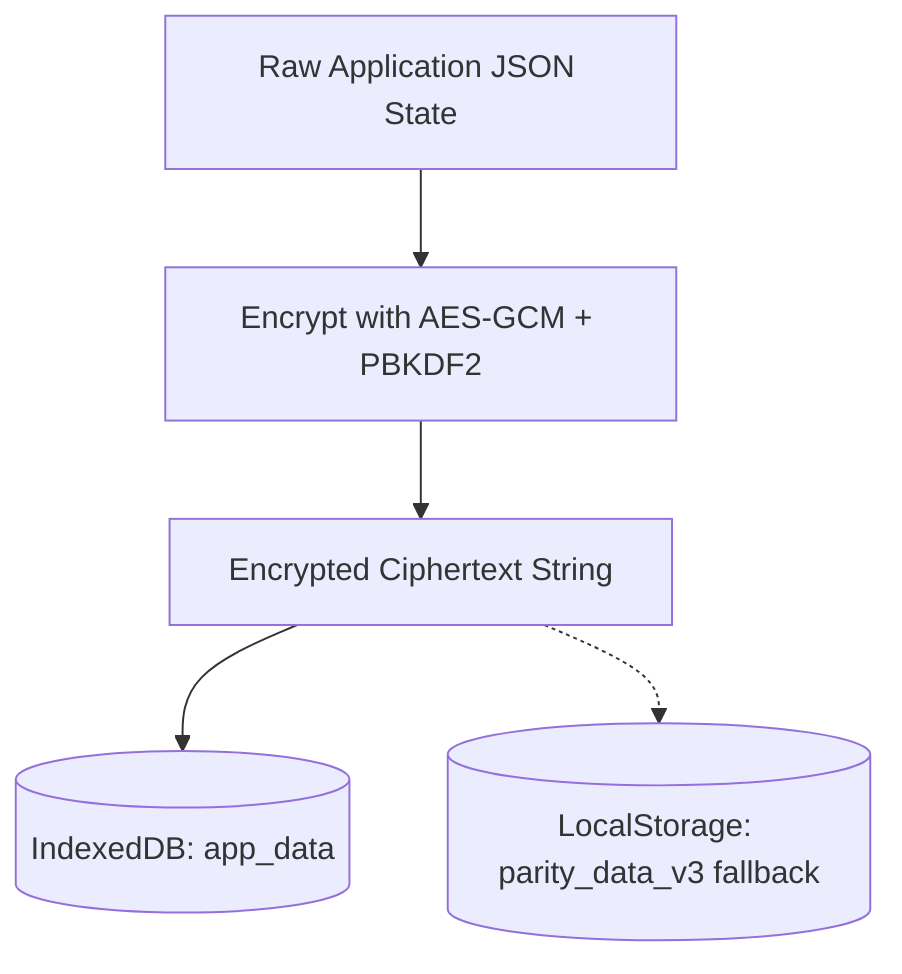

# Security & Cryptography in PARITY

PARITY is a **privacy-first, local-first** application. All user financial data is encrypted at rest using high-standard web cryptography.

## Cryptography Engine

All encryption and decryption logic resides in `services/crypto.ts` utilizing the browser's native **Web Crypto API**.

### Mechanisms:
- **Key Derivation:** Uses **PBKDF2** (Password-Based Key Derivation Function 2) with SHA-256 to derive encryption keys from the user password/secret.
- **Symmetric Encryption:** Uses **AES-GCM** (Advanced Encryption Standard - Galois/Counter Mode) with 256-bit keys for secure encryption of JSON data payloads.
- **Salt & IV:** Randomly generated cryptographic values (initialization vectors) are bundled with encrypted payloads to prevent replay attacks and pattern analysis.

## Storage Architecture

### 1. IndexedDB (Primary Store)
- Database schema and persistence are orchestrated in `services/db.ts`.
- The `app_data` object store acts as the encrypted container.

### 2. LocalStorage (Fallback / Settings)
- **Encrypted Fallback:** `parity_data_v3` holds the full encrypted backup.
- **Unencrypted Metadata:** Pure UI preferences that do not compromise privacy are saved in plain text under key names such as:
  - `app_theme`
  - `displayCurrency`
  - `isDevMode`
  - `activeProfileId`
  - `navbarFavorites`

## Offline Sync & Cloud Backups
- **Offline Queue:** Mutations are temporarily buffered locally in a sync queue (`services/sync.ts`) and committed when a connection is reestablished.
- **Google Drive Sync:** Optional backup feature that stores the same encrypted file format in the user's personal Google Drive, keeping data ownership strictly in user hands.
