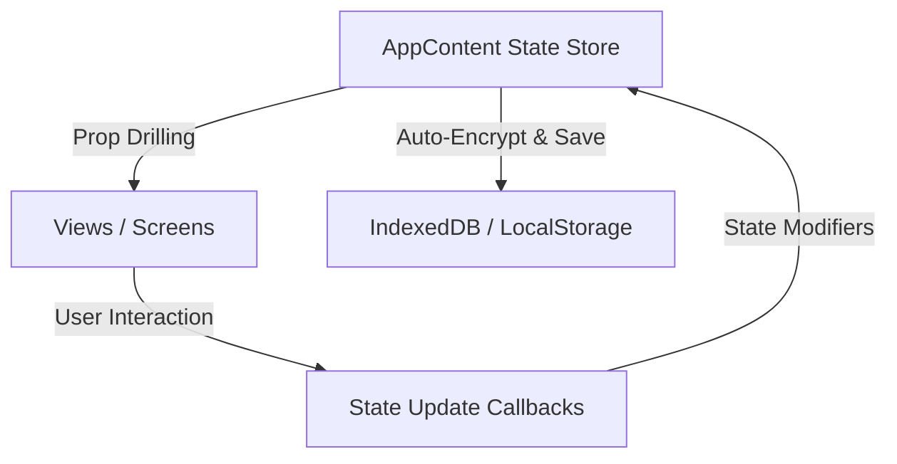

# State Management in PARITY

This document explains the state architecture within the PARITY application.

## Single Source of Truth

PARITY intentionally avoids external state management libraries (such as Redux, Zustand, or XState) to minimize bundle size, avoid dependency overhead, and keep the application state highly deterministic and serializable for encryption.

All core app state is centralized in the `AppContent` component inside [App.tsx](file:///Users/metalsyntax/Documents/GitHub/PARITY/apps/web/App.tsx).

### State Domains Managed:

1. **Entities:**
   - `accounts`: List of financial accounts (bank, cash, crypto, etc.)
   - `transactions`: All income, expense, and transfer records
   - `scheduledPayments`: Recurring transaction templates
   - `budgets`: Category spending limits
   - `goals`: Savings targets
   - `shoppingLists`: Items and price estimations

2. **Currency Exchange Rates:**
   - Fetched from official/parallel APIs (e.g., `ve.dolarapi.com`).
   - Handles parallel rate tracking (essential for the Venezuelan economy context).
   - Tracks `exchangeRate`, `usdRateParallel`, `euroRate`, and `euroRateParallel`.

3. **Multi-Profile Control:**
   - Multiple users or environments can exist on the same client.
   - Managed via `profiles`, `activeProfileId`, and the derived `userProfile`.

4. **UI & View State:**
   - `currentView`: Controls the active screen (Dashboard, BudgetView, AnalysisView, etc.).
   - `isDevMode`: Toggles developer-only capabilities.
   - `displayCurrency`: Preferred base currency for calculations.
   - `navbarFavorites`: Customizable quick links on the navigation bar.

## Data Flow

### Best Practices:
- Keep child components functional and stateless.
- Pass down explicit modifier functions (e.g., `handleAddTransaction`, `handleUpdateAccount`) rather than exposing raw setters.
- Always use the helper types defined in `packages/core/src/types.ts` when modifying entities.
